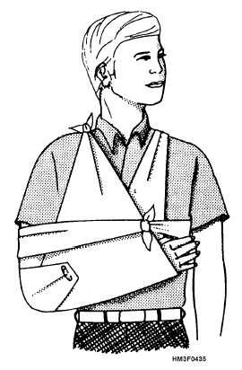
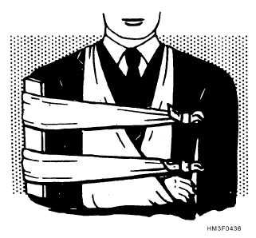

# Fractures, Sprains, and Dislocations

## Recognizing a fracture

Deformity, point tenderness over bone, swelling, bruising, grating (crepitus), inability to bear weight, or bone through skin (open fracture). When in doubt, splint it as a fracture.

## Always check CSM

Before and after splinting, check below the injury:
- **C**irculation – pulse, color, warmth, capillary refill
- **S**ensation – can they feel your touch?
- **M**otion – can they wiggle fingers/toes?

Loss of CSM after splinting means the splint is too tight — loosen it.

## Splinting principles

1. Immobilize the joint above and below a broken bone, or the bones above and below an injured joint.
2. Pad generously (clothing, foam, moss wrapped in cloth). Pad bony prominences and hollows.
3. Splint in the position of function: hand curled around a rolled sock, ankle at 90°, knee slightly bent.
4. Rigid material: sticks, tent poles, rolled magazines, cardboard, sleeping pads, trekking poles.
5. Secure with cloth strips, tape, belts. Tie knots on the splint side, not over the injury.
6. Elevate and apply cold (20 minutes on/off) for the first 48 hours.

### Specific splints

- **Forearm/wrist:** padded rigid board from elbow to past fingertips, then a sling and swathe (binding the arm to the chest).
- **Collarbone/shoulder:** sling and swathe.
- **Ankle:** a pillow or rolled sleeping pad wrapped in a U around foot and leg.
- **Lower leg:** rigid splints on both sides from mid-thigh to foot, or buddy-splint to the good leg with padding between.
- **Finger/toe:** buddy-tape to the neighbor with padding between.

## Open fractures

Control bleeding, irrigate thoroughly with drinkable water, cover with a clean moist dressing, splint. Do not deliberately push bone back in (it may retract on its own when the limb is aligned). Very high infection risk; needs surgical care and antibiotics.

## Femur (thigh) fractures

Can lose 1–1.5 liters of blood internally. Treat for shock. A traction splint (trained use only) reduces pain and bleeding. Improvised: a long rigid splint from armpit to past the foot on the outside and another from groin to foot on the inside.

## Pelvis

Pain in hips or groin after a fall or crash and unable to stand. Do not rock the pelvis to test it. Wrap a sheet or jacket tightly around the hips at the level of the bony bumps on the sides of the hips (greater trochanters) to stabilize. High risk of fatal internal bleeding.

## Spine

Suspect after falls from height, diving, vehicle crashes, or head injury. Signs: neck/back pain, numbness, tingling, weakness. Keep head in line with body; log-roll with several helpers. If the person is alert, sober, has no neck pain or tenderness, no numbness or weakness, and no distracting painful injury, spinal injury is unlikely.

## Sprains

**RICE:** Rest, Ice (20 minutes every 2–3 hours for 48 hours), Compression (elastic wrap, not too tight), Elevation. Start gentle motion as pain allows after 48–72 hours. If a person cannot take four steps on an ankle, or has bony tenderness at the back edge of either ankle knob, suspect a fracture.

## Dislocations

Only attempt reduction when far from care and circulation is compromised, or for simple well-documented reductions by someone trained:
- **Finger:** gentle traction along the line of the finger, then buddy-tape.
- **Kneecap (patella):** slowly straighten the knee while gently pushing the kneecap back toward the midline.
- **Shoulder (anterior):** relaxation-based techniques (external rotation, Cunningham) work better than force. Never yank. If it does not reduce after a few gentle attempts, sling and evacuate.

Always check CSM before and after. Splint after reduction.
