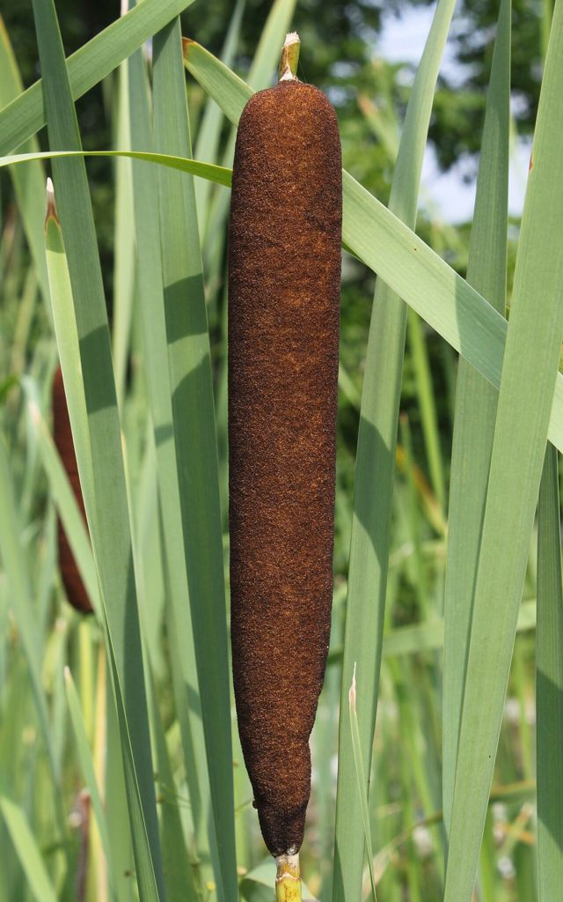

# Foraging Safety Rules and Plant Identification

Wild food can stretch supplies, but foraging calories are small compared to the risk of poisoning. Learn 10–20 abundant, easy, lookalike-free plants in your region *before* you need them.

## The golden rules

1. **100% positive ID or don't eat it.** Use at least two independent features plus habitat and season. Learn the plant across its whole life cycle.
2. **Know the deadly lookalikes first.** Every edible in this knowledge base lists its dangerous twins — learn those before the edible.
3. **Right part, right season, right preparation.** Pokeweed shoots, elderberries, and acorns are edible only when prepared correctly; other parts of the same plant are toxic.
4. **Start small.** Even with a confident ID, eat a small amount of a new food and wait 24 hours. Allergies and individual sensitivity exist.
5. **Avoid contaminated sites:** roadsides (lead, herbicides), railways, industrial sites, lawns that may be sprayed, water downstream of farms or mines, and, after a nuclear or chemical event, anything exposed to fallout.
6. **Avoid the carrot/parsley family (Apiaceae) unless expert** — it holds the deadliest plants in North America (water hemlock, poison hemlock) alongside edible wild carrot and cow parsnip.
7. **Mushrooms are a separate, far more dangerous skill.** See *Mushroom Safety*.

## Red flags (avoid unless positively identified as safe)

These are warning signs, not proof of toxicity:
- Milky or discolored sap (though dandelion and some lettuces are exceptions)
- Umbrella-shaped flower clusters (carrot family)
- Beans, bulbs, or seeds inside pods
- Bitter or soapy taste
- Fine hairs, spines, or thorns (except known plants like nettles and blackberries)
- Leaves in groups of three ("leaves of three, let it be" — poison ivy/oak)
- Almond scent in crushed leaves (cyanide compounds — e.g., wild cherry leaves)
- White or yellow berries (many toxic; e.g., poison ivy, mistletoe, baneberry)

## Universal Edibility Test (last resort only)

The US Army test is slow (24+ hours per plant part), needs a plentiful plant, and **does not detect many deadly toxins** — water hemlock can kill from a single bite, and many mushroom toxins act after days. Use only when starving with no known foods, and never on mushrooms or carrot-family plants.

1. Fast 8 hours (water only). Test one part of one plant at a time.
2. Smell it. Strong, unpleasant, or almond odor → reject.
3. Rub on the inner wrist/elbow; wait 15 minutes for burning, itching, rash.
4. Prepare it as you would eat it (cooking reduces many toxins).
5. Touch to lip for 3 minutes; then on tongue for 15 minutes; then chew (do not swallow) for 15 minutes. Any burning, numbness, bitterness → reject.
6. Swallow a small amount; wait 8 hours, eating nothing else. If ill, induce vomiting and drink lots of water.
7. If no effects, eat ¼ cup, wait another 8 hours. If still fine, that part, prepared that way, is likely safe.

## Identification tools

- A printed regional field guide (Peterson, Thayer, Elias & Dykeman) beats any app when the power is out.
- Hand lens, notebook, pressed specimens.
- Learn botanical terms: leaf arrangement (alternate/opposite/whorled), leaf shape and margins, stem cross-section (round/square/triangular), flower parts, roots.
- Local extension offices, native-plant societies, and experienced foragers are the best teachers while they're accessible.

## High-value, low-risk plants (nearly nationwide)

Cattail, dandelion, plantain (*Plantago*), chickweed, lamb's quarters, purslane, wild blackberry/raspberry, wild strawberry, clover, stinging nettle (cooked), curly dock (cooked, in moderation), acorns (leached), pine (inner bark, needle tea — but see the ponderosa note and yew warning), rose hips, and grass seeds. See the regional guides for details and lookalikes.

