# Deadly and Toxic Plants of the United States

Learn these before you forage anything. If poisoning is suspected, see the first-aid section at the end.

## Water hemlock (*Cicuta* spp.) — nationwide, wet areas

- **Looks like:** wild carrot, wild parsnip, wild celery, cow parsnip, angelica, water parsnip. Umbrella clusters of small white flowers, 3–6 ft tall.
- **Key features:** stem base and roots have **chambers (hollow partitions)** when cut lengthwise and ooze yellowish oily liquid with a carrot/parsnip smell; leaf veins run to the **notches** between teeth rather than to the tips; grows in wet ground, ditches, marshes, stream banks.
- **Effect:** violent seizures within 15–60 minutes, often fatal. Cicutoxin.

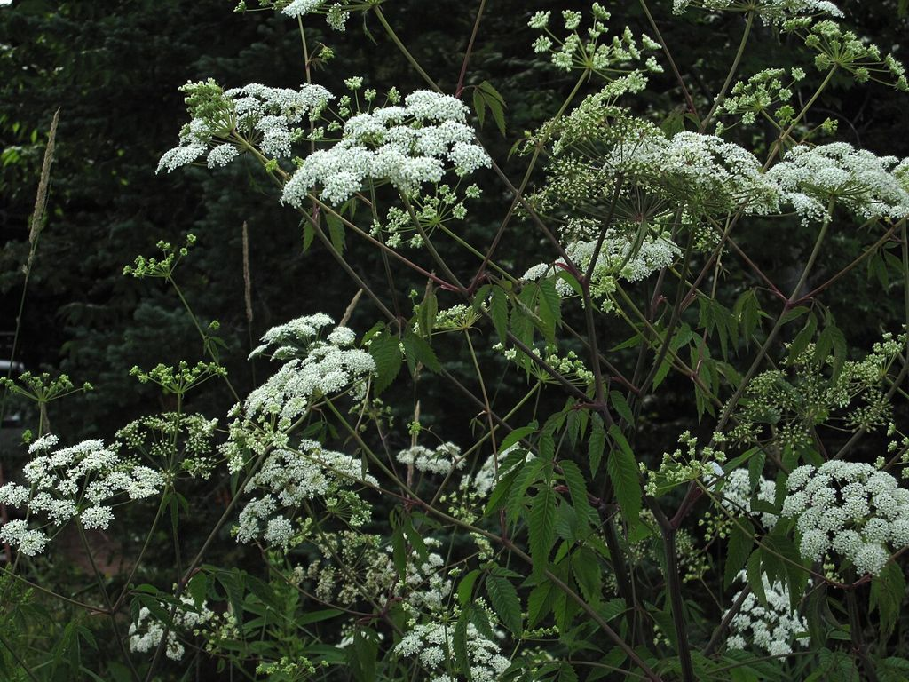

## Poison hemlock (*Conium maculatum*) — nationwide, disturbed ground

- **Looks like:** wild carrot (Queen Anne's lace), parsley, fennel, chervil.
- **Key features:** smooth, hairless stems with **purple blotches**, often with a whitish bloom; finely divided fern-like leaves; musty "mousy" smell when crushed; 3–10 ft tall. Queen Anne's lace has **hairy** stems and smells like carrot.
- **Effect:** ascending paralysis, respiratory failure (it killed Socrates).

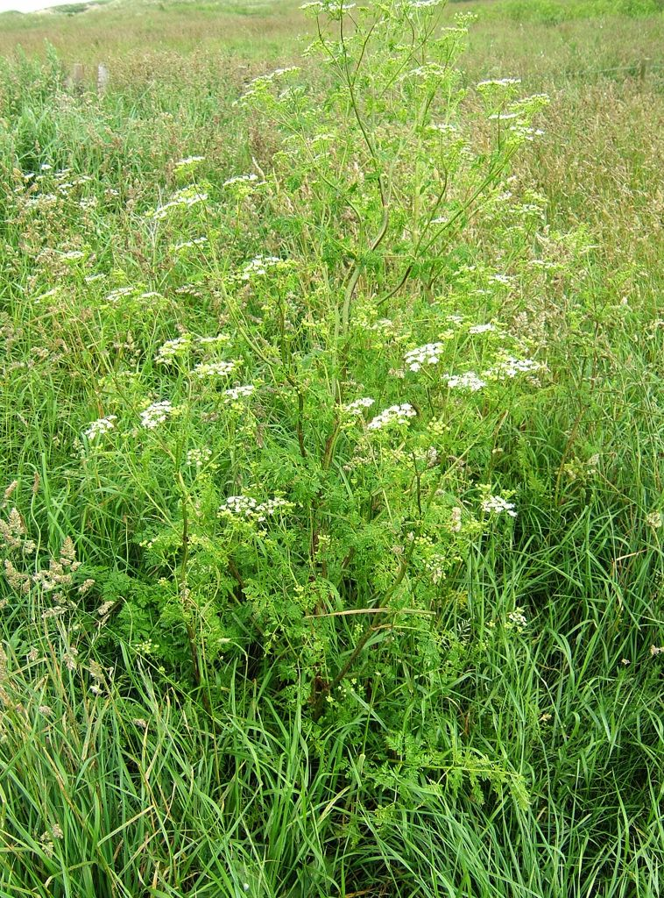
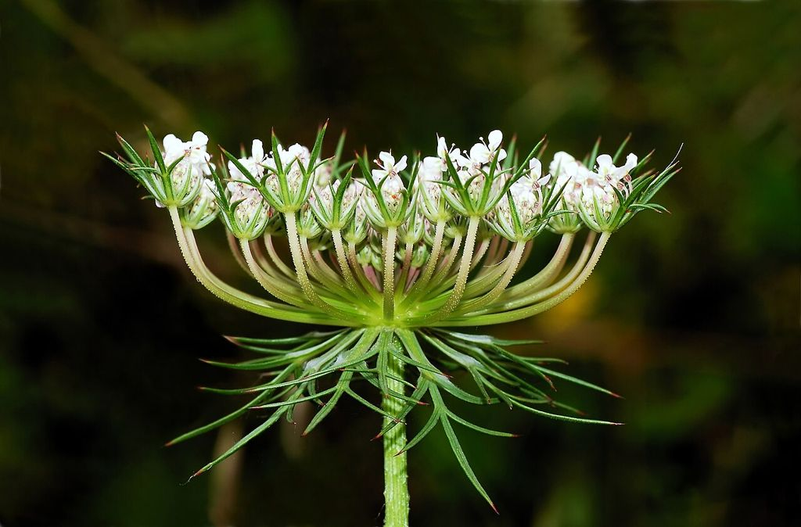

## Death camas (*Toxicoscordion* / *Zigadenus*) — West, Plains, parts of Midwest and Southeast

- **Looks like:** wild onion, blue camas (edible), wild garlic.
- **Key features:** grass-like leaves, cream-white flowers in a cluster; bulb **lacks onion smell**. Rule: if it doesn't smell like onion, it isn't an onion — but smell your fingers, since onion residue can fool you.
- **Effect:** vomiting, slow heart rate, low blood pressure, can be fatal.

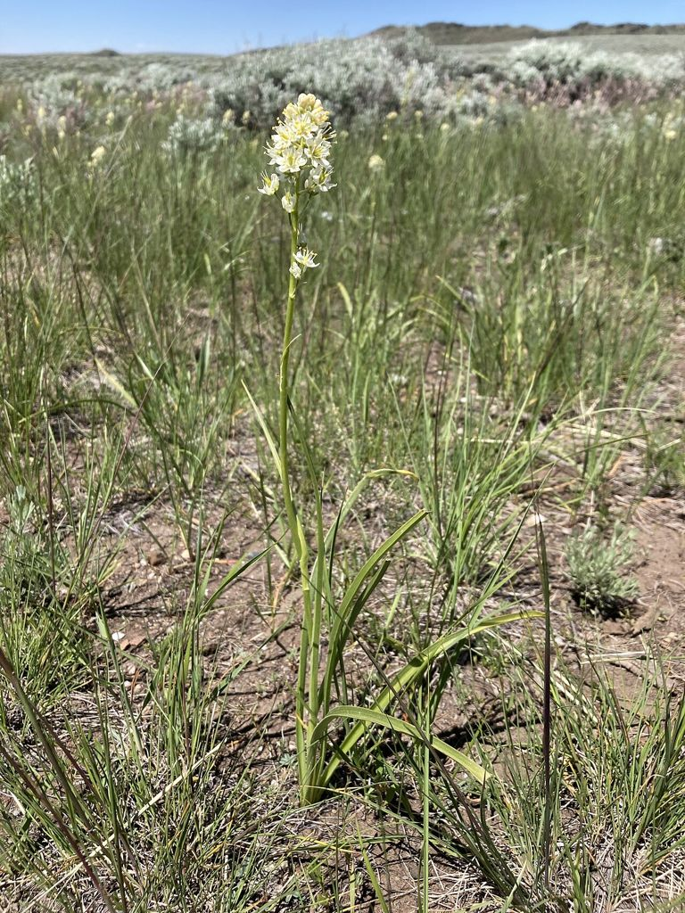
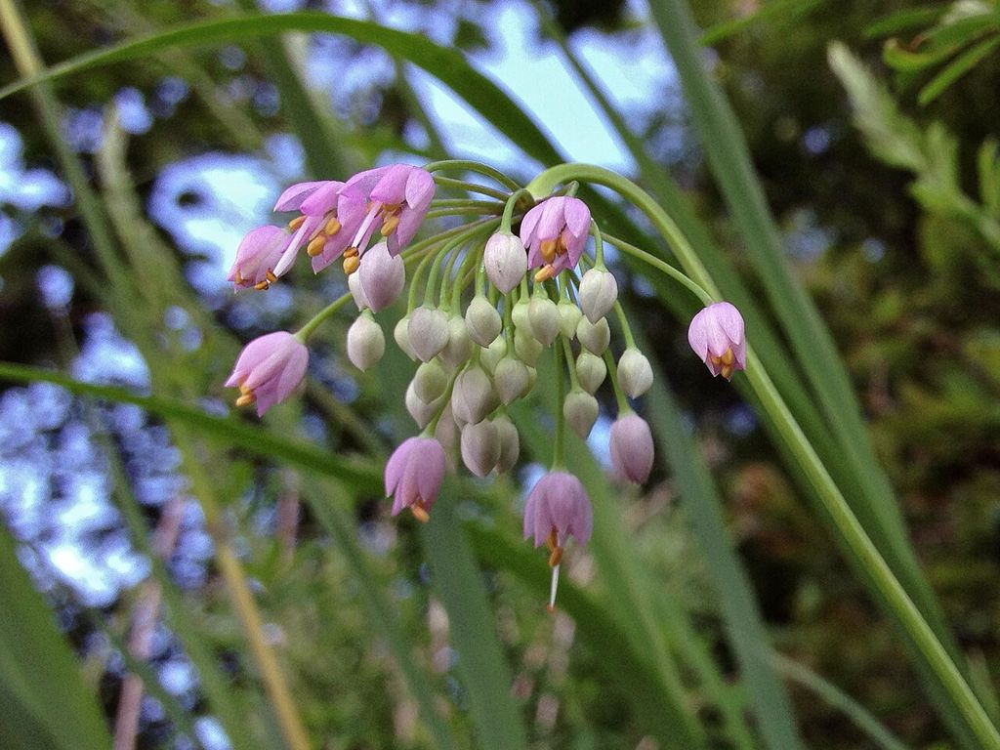
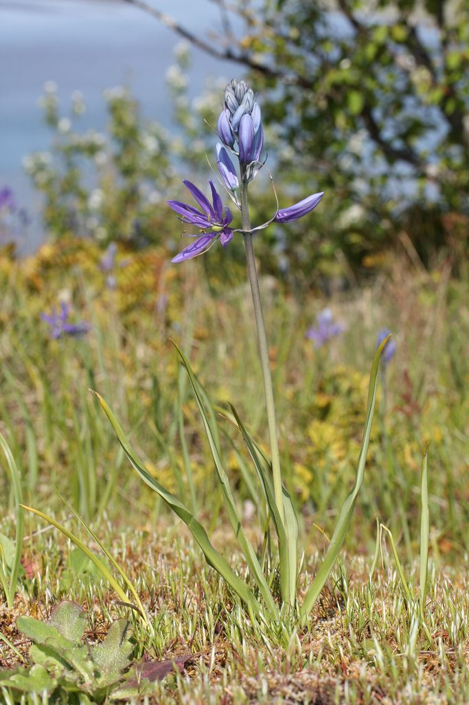

## Pokeweed (*Phytolacca americana*) — East, Midwest, South

- Large plant with purple-red stems and dark purple berries in drooping clusters.
- **All parts toxic,** especially root and berries. Very young shoots (under ~8 inches, no purple) are a traditional food only after boiling in two or three changes of water. Mature plants and roots: never.

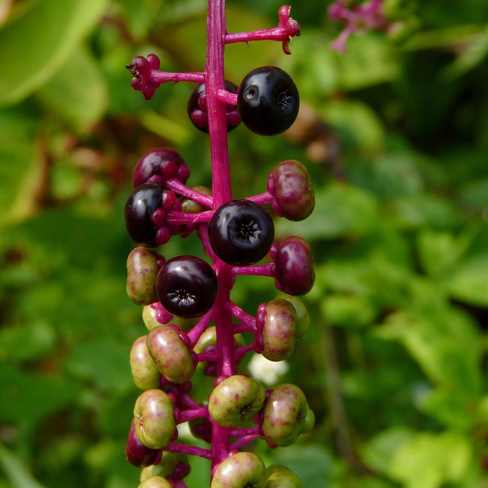

## Nightshades (*Solanum*, *Atropa*, *Datura*)

- **Jimsonweed / thorn apple (*Datura*):** large white or purple trumpet flowers, spiny seed pods, foul smell. Hallucinations, delirium, high fever, death. Nationwide.
- **Bittersweet and black nightshade:** clusters of berries (green → red or black). Unripe berries toxic. Avoid.
- Remember: the leaves and green parts of potatoes and tomatoes are also toxic.

## Other dangerous plants

- **Yew (*Taxus*):** evergreen shrub/tree with flat needles and red cup-shaped berries. Everything except the red fleshy cup is lethal (the seed inside is deadly). Common in landscaping. Do not confuse with hemlock-tree or fir needles for tea.
- **Foxglove (*Digitalis*), lily of the valley (*Convallaria*), oleander (*Nerium*):** cardiac glycosides — irregular heartbeat, death. Lily of the valley leaves resemble ramps (wild leeks) — **ramps smell strongly of onion/garlic**.
- **False hellebore (*Veratrum*):** pleated, ribbed leaves resembling ramps or skunk cabbage in spring. Severe toxicity.
- **Moonseed (*Menispermum*):** vine whose fruit resembles wild grapes but contains a **single crescent-shaped seed**; grapes have several round/teardrop seeds and forked tendrils. Moonseed has no tendrils.
- **Baneberry (*Actaea*):** white ("doll's eyes") or red berries. Toxic.
- **Castor bean (*Ricinus*):** ricin; seeds are deadly if chewed.
- **White snakeroot (*Ageratina altissima*):** causes "milk sickness" — toxin passes into the milk of cows that graze it.
- **Buckeye (*Aesculus*):** nuts resemble chestnuts but are toxic; chestnuts have spiny burrs with pointed-tip nuts, buckeyes have smooth or warty husks and a single round nut.
- **Manchineel (Florida Keys/south Florida):** small apple-like fruit; extremely toxic, even sap and rainwater dripping off it cause burns.
- **Mayapple:** only the fully ripe yellow fruit is edible (in moderation); everything else, including unripe fruit, is toxic.

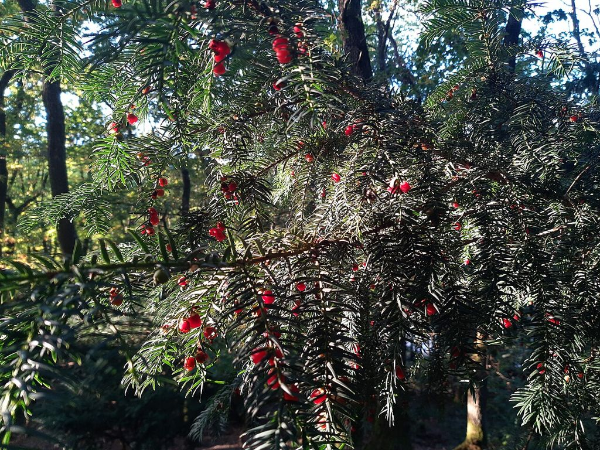
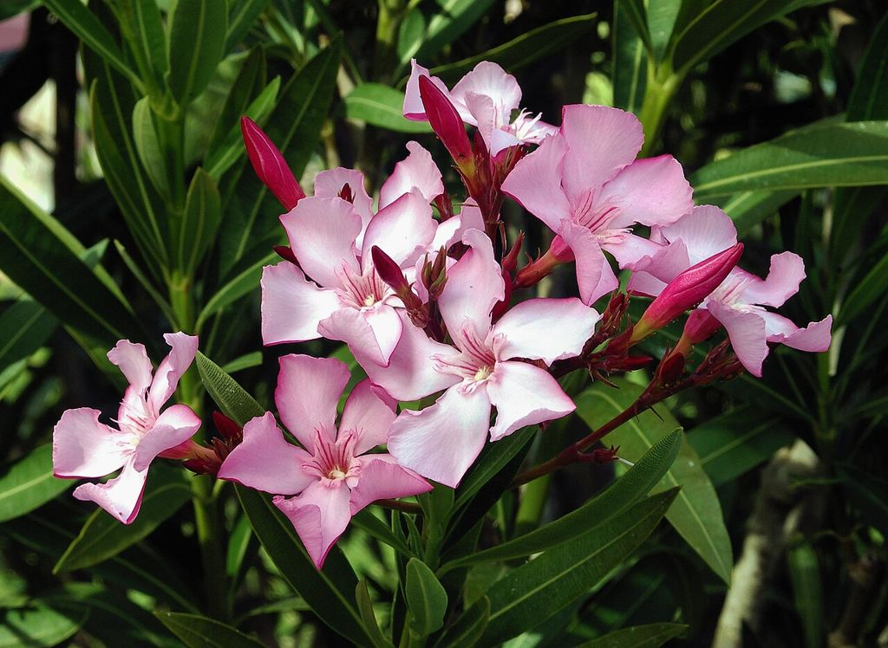
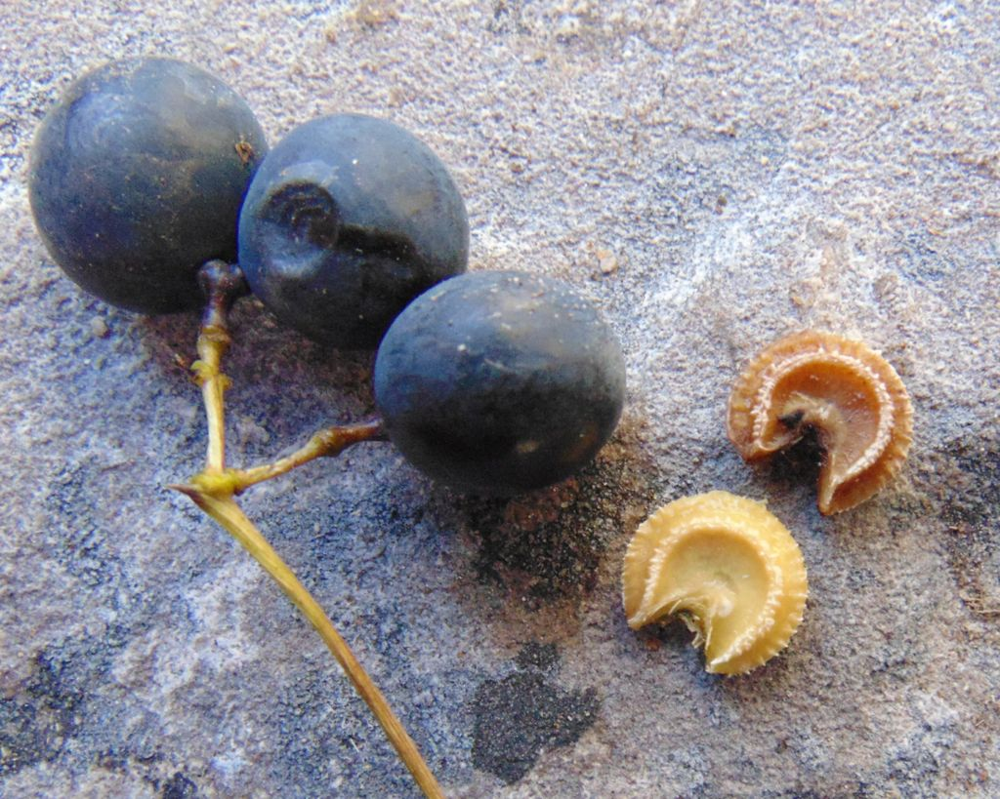
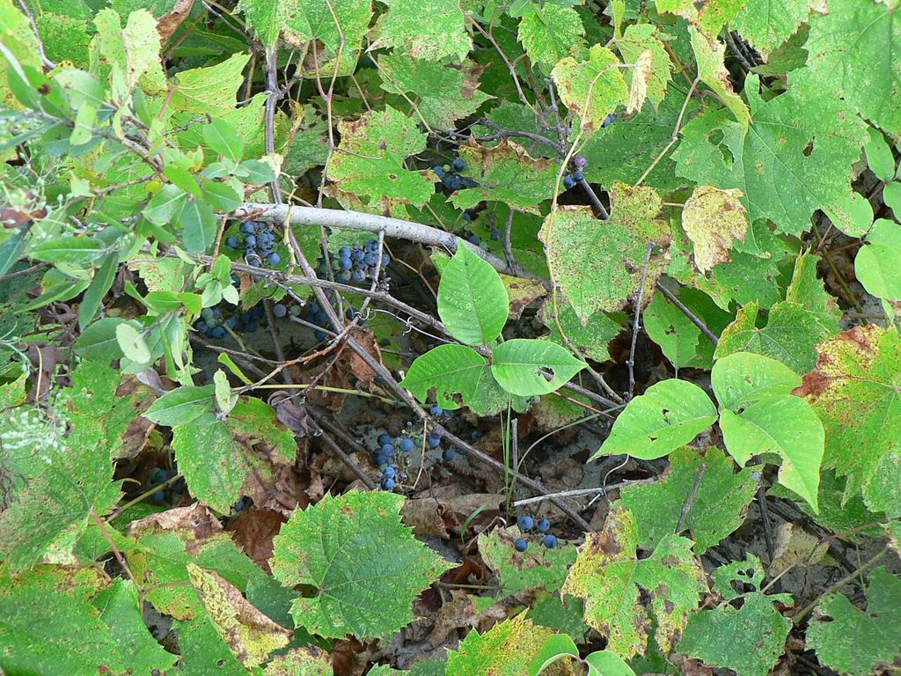

## Contact irritants

- **Poison ivy, poison oak, poison sumac:** urushiol oil. Wash skin with soap and cool water within 30 minutes; wash clothes and tools. Never burn — smoke inhaled causes severe lung reactions. Jewelweed is a traditional remedy for the rash.
- **Wild parsnip, giant hogweed, cow parsnip sap:** phototoxic — sap plus sunlight causes severe burns and blisters. Cover and wash exposed skin.
- **Stinging nettle:** painful but harmless; dock leaves or plantain juice soothe.

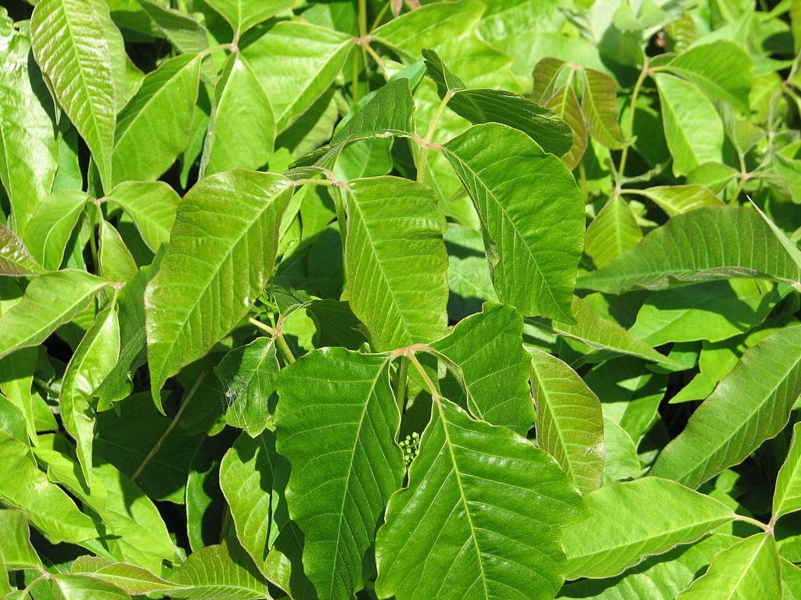
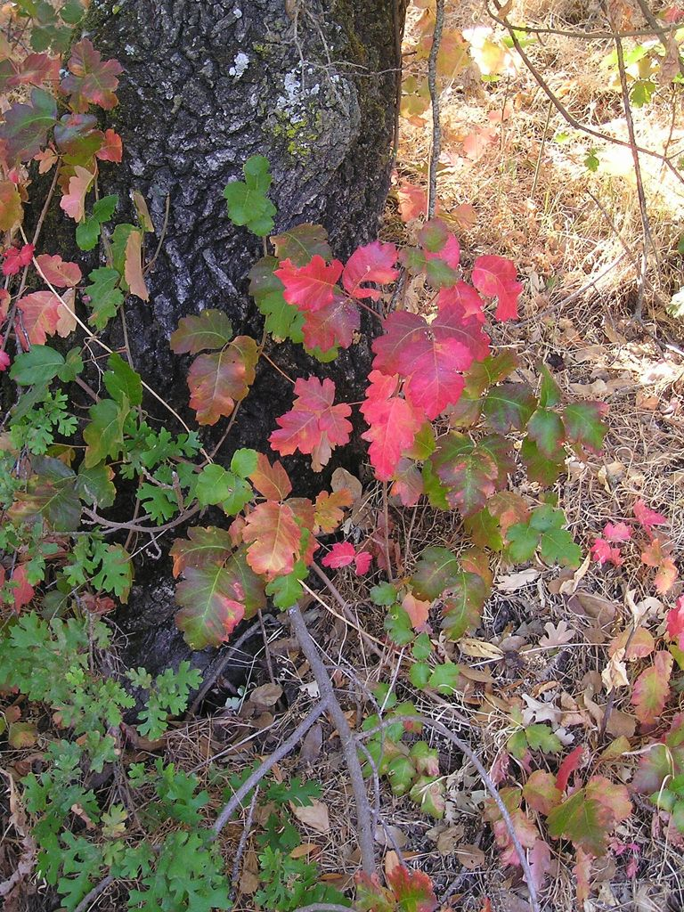
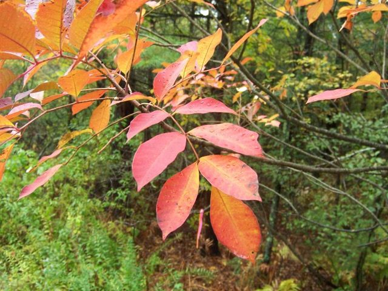

## Suspected plant poisoning: first aid

1. Remove remaining plant material from the mouth. Keep a sample for identification.
2. Do **not** induce vomiting if the person is drowsy, seizing, or has swallowed a caustic substance.
3. **Activated charcoal**, if available and the person is fully awake with an intact gag reflex, may bind toxins (adult ~50 g mixed in water) within the first hour.
4. Seizures: protect from injury, place on side afterward. Monitor breathing; rescue breaths if it stops.
5. Contact poison control (US: 1-800-222-1222) if any phone works.
