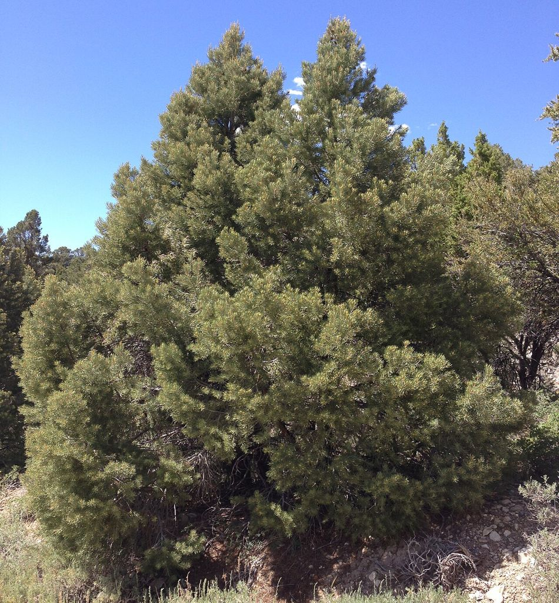
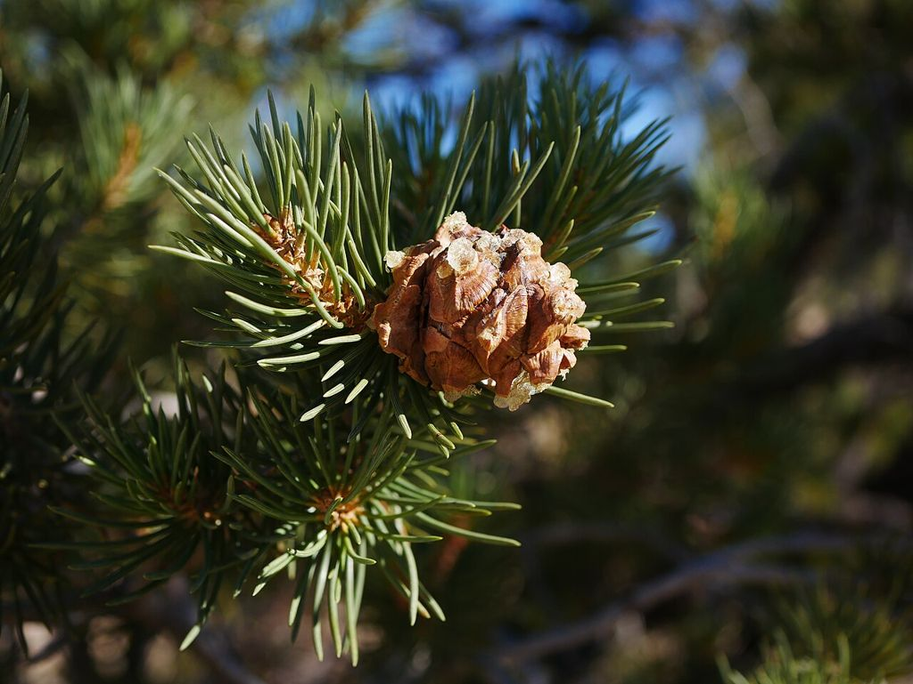
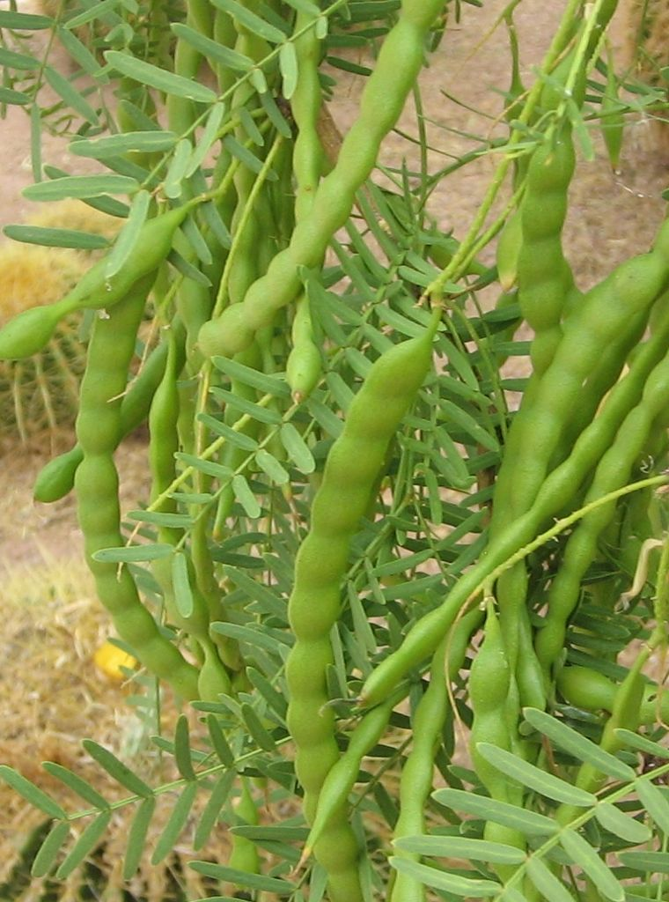
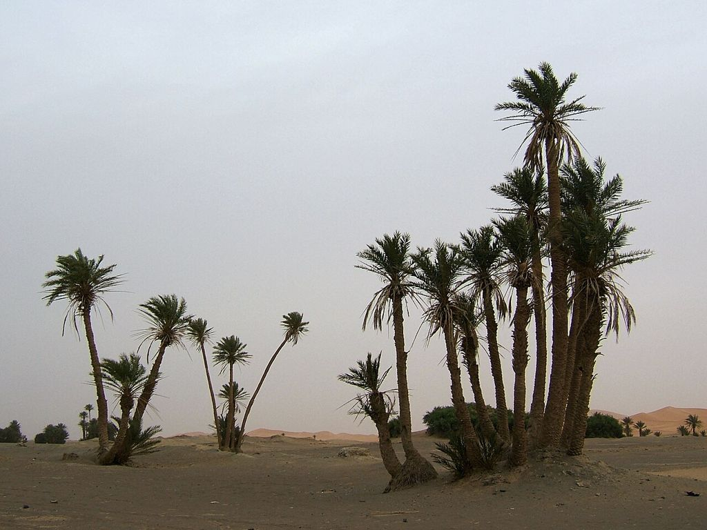
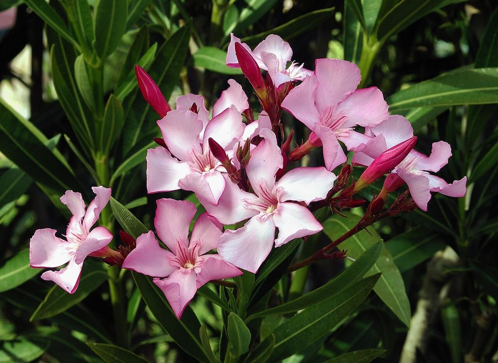

# Reno and Las Vegas, Nevada: Wild Edible and Medicinal Plants and Trees

Nevada's two big metro areas sit in very different ecosystems:

- **Reno / Sparks / Carson City:** **Great Basin high desert** at about 4,400–5,000 ft, at the eastern foot of the Sierra Nevada. Cold winters (often below 20°F), hot dry summers, about 7 inches of rain a year. Sagebrush steppe in the valleys, pinyon-juniper in the hills, Jeffrey pine and fir toward Lake Tahoe. Water comes from the Truckee River, fed by Lake Tahoe.
- **Las Vegas / Henderson:** **Mojave Desert** at about 2,000–2,800 ft. Summer highs of 105–117°F, mild winters, about 4 inches of rain a year. Creosote bush, mesquite, yucca, and Joshua trees. About 90% of the water comes from Lake Mead (Colorado River). The Spring Mountains (Mount Charleston, 11,900 ft) to the west hold pine and fir forests and springs.

Both cities are surrounded by **very limited wild food**. Most calories within reach of a city are in **urban fruit and nut trees and gardens**, so both sections include them. Indigenous peoples (Washoe and Northern Paiute around Reno, Southern Paiute around Las Vegas) lived on pinyon nuts, seeds, mesquite, agave, and fish and game. Their food plants appear below.

## Reno and the Great Basin (Truckee Meadows, Carson Valley, Washoe Valley)

### Native trees

- **Singleleaf pinyon pine (*Pinus monophylla*)** — the most important food tree in the Great Basin. It's the only pine with **single needles** (not in bundles). Short, rounded trees on hillsides from about 5,000–7,500 ft (Pine Nut Mountains, Virginia Range, Peavine foothills). **Nuts ripen in September–October**: pick green cones before they open and roast them near a fire until they open, or gather fallen nuts. A good crop comes every 2–7 years. Pinyon nuts are high in fat and calories, and were a Washoe and Paiute winter staple. Pitch is a wound dressing and glue.
- **Utah juniper (*Juniperus osteosperma*)** — bluish berry-like cones. Use a few as flavoring or tea only (avoid in pregnancy or with kidney disease). The shredded bark is excellent tinder and insulation.
- **Jeffrey pine (*P. jeffreyi*) and ponderosa (*P. ponderosa*)** — on the Sierra slopes west of Reno and around Tahoe. Jeffrey bark smells like vanilla or butterscotch. The large seeds are edible and the inner bark is emergency food. Needle tea provides vitamin C (not for pregnant people).
- **Fremont cottonwood (*Populus fremontii*) and black cottonwood** — along the Truckee River and Steamboat Creek; they mark **water**. Resinous spring buds make a salve, and the inner bark is emergency food.
- **Willows (*Salix*)** — along every stream. Inner-bark tea is a salicin pain reliever (same cautions as aspirin), and the shoots work for basketry and fish traps.
- **Quaking aspen (*Populus tremuloides*)** — at higher elevations toward Tahoe and Mount Rose. Inner bark is emergency food, and the white powder on the bark was a traditional sunscreen.
- **Curl-leaf mountain mahogany (*Cercocarpus ledifolius*)** — very hard, dense wood for tools and long-burning fuel. Not food.
- **Chokecherry (*Prunus virginiana*)** — shrubby trees in canyons, with fruit in late summer. Eat the flesh only; pits and leaves are toxic.

### Urban and introduced trees (Reno/Sparks)

Reno's older neighborhoods (Old Southwest, Wells Avenue, Sparks) and parks have many food trees:
- **Apple, crabapple, pear, apricot, plum, cherry, peach** — August–October. In an emergency, check yards and vacant lots and harvest where it's permitted.
- **Mulberry** — June–July fruit.
- **English walnut and black walnut** — fall nuts.
- **Russian olive (*Elaeagnus angustifolia*, invasive)** — silvery leaves and thorns, abundant along the Truckee. Its mealy, sweet fruit is edible in fall.
- **Siberian elm (*Ulmus pumila*, invasive)** — very common. The green, papery seeds (samaras) in early spring are edible raw or cooked, and so are the young leaves.
- **Black locust** — the fragrant white spring **flowers** are edible cooked. **Seeds, bark, leaves, and pods are toxic.**
- **Avoid:** ornamental yew (deadly), horse chestnut and buckeye (toxic nuts), privet berries.

### Shrubs and herbs

- **Indian ricegrass (*Achnatherum hymenoides*)** — a bunchgrass with open, airy seed heads on sandy soils. The seeds (June–July) were a major Paiute staple: parch, winnow, and grind them into flour.
- **Great Basin wildrye, wheatgrasses, and other grass seeds** — gathered by beating seed heads into a basket. **Discard any purple-black ergot bodies** (toxic fungus).
- **Saltbush (*Atriplex*)** — salty, silvery shrubs on alkaline flats. Young leaves can be cooked as greens and the seeds ground. Shadscale and fourwing saltbush are both used.
- **Wood's rose (*Rosa woodsii*)** — along creeks. Hips (fall–winter) are rich in vitamin C; remove the hairy seeds.
- **Golden currant and wax currant (*Ribes*)**, **buffaloberry**, **desert peach (*Prunus andersonii*)** — small summer fruits on the hills.
- **Cattail and tule (hardstem bulrush)** — at Washoe Lake, the Truckee River, Pyramid Lake margins, and wetland parks (Rancho San Rafael, Oxbow). Shoots, pollen, and rhizome starch are edible (see the *Northeast* guide). Avoid polluted urban drainages.
- **Wild onion (*Allium*)** and **sego lily (*Calochortus*)** — spring bulbs. **Death camas grows in the same places.** Eat only what smells clearly of onion, and dig sego lilies only while they're in flower.
- **Biscuitroot (*Lomatium*)** — a traditional spring root, but in the carrot family. Experts only.
- **Russian thistle (tumbleweed)** — very young shoots (under 4 inches, before they turn spiny) are a cooked green. **Lamb's quarters, purslane, dandelion, curly dock, and mustards** grow in disturbed lots and ditches.
- **Mormon tea (*Ephedra nevadensis*)** — jointed green stems for tea. It's a stimulant, so avoid it with heart conditions.

### Medicinal plants (Reno area)

- **Big sagebrush (*Artemisia tridentata*)** — the dominant shrub. A leaf wash or steam is traditional for colds and as an antiseptic wash. Strong; don't drink much.
- **Rubber rabbitbrush** — yellow-flowered shrub. Traditional cough tea in small amounts. Not food.
- **Yarrow, plantain, willow bark, Wood's rose, Mormon tea**
- **Balsamroot (*Balsamorhiza sagittata*)** — big yellow spring sunflowers on hillsides. Roots, young shoots, and roasted seeds are edible.
- **Pinyon pitch** — wound salve and drawing poultice.

### Toxic plants (Reno area)

- Water hemlock along the Truckee and Carson rivers and irrigation ditches
- Poison hemlock in fields and ditches
- Death camas
- Larkspur, lupine, and halogeton (alkali flats; mostly kills livestock)
- Sacred datura and jimsonweed
- Bittersweet nightshade
- Ornamental oleander (less common in Reno than in Las Vegas), yew, and chinaberry
- Low larkspur and arrowgrass near wetlands

### Water near Reno

The Truckee River runs through downtown year-round (treat everything; there is urban runoff). Other sources: Steamboat Creek, Galena Creek and other Mount Rose creeks, Hunter Creek, Washoe Lake, irrigation ditches (agricultural runoff), and springs in the Carson Range. Pyramid Lake is large but slightly saline-alkaline. Some hot springs (Steamboat) are mineral-laden and not drinkable.

### Seasonal calendar (Reno)

- **Spring (Mar–May):** Siberian elm samaras, balsamroot, wild onion and sego lily (with care), cattail shoots, black locust flowers, dandelion, mustard
- **Summer:** ricegrass and other grass seeds, currants, mulberries, apricots and cherries, purslane, lamb's quarters
- **Fall:** **pinyon nuts (Sept–Oct)**, apples, pears, walnuts, chokecherries, Russian olive fruit, rose hips
- **Winter:** stored pinyon nuts and seeds, rose hips, cattail rhizome starch, pine-needle tea. Plan for cold: winter lows reach the single digits.

## Las Vegas and the Mojave Desert, Southwest (Las Vegas Valley, Henderson, Red Rock, Mount Charleston)

### Native trees

- **Honey mesquite (*Prosopis glandulosa*) and screwbean mesquite (*P. pubescens*)** — the most important wild food trees around Las Vegas. Look for them in washes, around old springs, and at Floyd Lamb Park (Tule Springs), Clark County Wetlands Park, and Corn Creek. Pods ripen **June–September**. Pick dry, tan pods **from the tree** (ground pods can grow aflatoxin mold) and grind them to a sweet flour. Screwbean pods are tightly coiled and also edible.
- **Joshua tree (*Yucca brevifolia*)** — northwest valley, Red Rock, Highway 95 corridor. The flower buds and flowers (spring) are edible roasted, and the seeds can be roasted. **Protected under Nevada law in normal times.**
- **Mojave yucca (*Yucca schidigera*) and banana yucca (*Y. baccata*)** — banana yucca fruits are baked or roasted, and flower stalks and flowers are cooked. Roots are soap, not food. Leaf fiber makes strong cordage.
- **Utah agave (*Agave utahensis*)** — limestone slopes of the Spring Mountains and Red Rock. The heart was **pit-roasted for 1–2 days** by the Southern Paiute; old roasting pits are visible at Red Rock. Never eat it raw (caustic).
- **Desert willow (*Chilopsis linearis*)** — washes. Flowers are edible, and the flower and bark tea is a traditional wound and antifungal wash.
- **Catclaw acacia (*Senegalia greggii*)** — hooked thorns; the pods were ground for meal. Low value and painful to harvest.
- **Spring Mountains / Mount Charleston (above about 6,000 ft):** singleleaf pinyon (**pine nuts in fall**), Utah juniper, ponderosa pine, white fir, and Great Basin bristlecone pine (ancient and protected, not a food source). Quaking aspen grows in moist pockets.
- **Fremont cottonwood and willows** — along Las Vegas Wash and at springs. **Indicators of water.**

### Urban and planted trees (Las Vegas)

Las Vegas has many planted food trees in yards, older neighborhoods, golf courses, and resort grounds:
- **Date palm (*Phoenix dactylifera*)** — common at resorts and in older yards. Female trees bear dates in **fall (Sept–Nov)**. Dates are very high in calories and dry well for storage.
- **California fan palm (*Washingtonia filifera*) and Mexican fan palm (*W. robusta*)** — everywhere. The small black fruits (late summer–fall) have thin, sweet, edible flesh around a large seed; the seeds can be ground. Watch for falling dead fronds.
- **Pomegranate, fig, apricot, peach, plum, jujube, loquat** — common yard trees. Figs give two crops (June and Aug–Sept). Pomegranates ripen Sept–Nov and store for months.
- **Citrus** — limited by frost, but sheltered yards have lemons and oranges.
- **Olive trees** — planting is restricted in Clark County, but older trees remain. The fruit is inedible until cured in brine or lye (see the *Lye* doc).
- **Mulberry** — new planting is banned in Clark County (pollen), but older trees exist. Most are fruitless males.
- **Pecan and pistachio** — occasional. Pistachios grow in Pahrump and Amargosa valley orchards.
- **Palo verde (*Parkinsonia*)** — planted as a landscape tree. Green seeds are eaten raw like peas and mature seeds cooked.
- **Do not eat:** oleander (everywhere, deadly), chinaberry (deadly berries), African sumac berries, Mexican bird-of-paradise seeds (toxic), lantana berries, Brazilian pepper.

### Shrubs, cacti, and herbs

- **Prickly pear (*Opuntia*)** — common in yards and the desert. Eat the pads in spring and the fruit (tunas) in late summer; burn or peel off the glochids. **Beavertail cactus** pads and buds were also eaten.
- **Cholla (*Cylindropuntia*)** — buds in spring, de-spined and boiled.
- **Barrel cactus** — yellow fruits are edible. **Don't drink the pulp as water.**
- **Creosote bush (*Larrea tridentata*)** — dominant shrub. A traditional external antiseptic wash; **no internal use** (liver toxicity).
- **Desert globemallow** — orange flowers. Mucilaginous leaves were used for soothing poultices and sore throat.
- **Desert chia (*Salvia columbariae*)** — seeds after wet winters, eaten soaked or roasted.
- **Saltbush (*Atriplex*)** — leaves and seeds, as in the Reno section.
- **Wolfberry (*Lycium*)** — small red berries in spring.
- **Mormon tea (*Ephedra*)** — tea; it's a stimulant.
- **Indian ricegrass** — seeds in late spring.
- **Weedy greens after rain:** purslane, amaranth, lamb's quarters, London rocket and other mustards, filaree (*Erodium* — young leaves).
- **Cattail and bulrush** — Clark County Wetlands Park and Las Vegas Wash. The water contains treated effluent and urban runoff, so cook everything and treat any water.

### Medicinal plants (Las Vegas area)

- **Creosote** — external use only
- **Desert willow** — wound and antifungal wash
- **Desert lavender (*Condea emoryi*)** — tea for colds
- **Brittlebush resin** — chewed as gum and used as a salve
- **Aloe** — very common in yards; gel for burns and sunburn
- **Jojoba (*Simmondsia*)** — planted; oil for skin. **Seeds are not food** (they cause diarrhea).
- **Prickly pear pad fillets** — traditional burn and wound poultice
- **Mormon tea and globemallow**

### Toxic plants (Las Vegas area)

- **Oleander** — planted as hedges along freeways, yards, and golf courses citywide. All parts are deadly, and so is the smoke from burning it.
- **Chinaberry**
- **Sacred datura** — common on vacant lots and roadsides, with big white trumpet flowers
- **Tree tobacco** — yellow tubular flowers
- **Castor bean**
- **Lantana**
- **Mexican bird-of-paradise** — seeds
- **Desert tobacco**
- **Jimsonweed**
- **Wild cucumber** (*Marah*, coyote melon) — toxic gourds

**Animals:** Mojave rattlesnake and sidewinder (see the *Venomous Bites* doc), Gila monster, black widows. Bark scorpions are rare here compared with Arizona.

### Water near Las Vegas

Survival water is the defining problem in Las Vegas. Options:
- **Lake Mead** (Boulder Beach, Las Vegas Bay): large but far from most neighborhoods, and the shoreline has receded
- **Las Vegas Wash:** perennial, but much of its flow is treated wastewater. Treat it heavily.
- **Springs in Red Rock Canyon** (Calico Tanks fill after rain, Red Spring, Willow Spring) and the Spring Mountains (Mount Charleston area creeks and springs)
- **Resort and community pools and fountains:** pool water is usable for flushing and washing; for drinking it needs filtering and disinfection. It's best avoided if heavily chemically treated or salt-chlorinated.
- **Water heaters and stored water** (see the *Water Purification* doc)

**In summer, plan on at least 1–2 gallons per person per day.** Move only at night, and never travel the desert in summer daytime heat.

### Seasonal calendar (Las Vegas)

- **Late winter–spring (Feb–May):** cholla and Joshua tree buds, yucca flowers and stalks, prickly pear pads, agave hearts (Spring Mountains), mustard and filaree greens, chia, wolfberries, loquats, apricots (late May)
- **Summer (Jun–Sep):** **mesquite pods**, figs, prickly pear fruit (Aug–Sep), peaches, plums, purslane. Heat is the main danger.
- **Fall (Sep–Nov):** **dates**, pomegranates, palm fruits, jujubes, figs (second crop), pinyon nuts (Mount Charleston), banana yucca fruit
- **Winter:** citrus in sheltered yards, stored dates, mesquite flour and nuts, greens after winter rains
