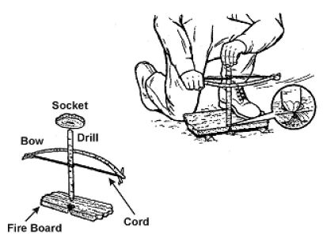

# Fire Craft

Fire provides warmth, water disinfection, cooking, signaling, light, and morale.

## The fire triangle and materials

Heat + fuel + oxygen. Gather everything **before** striking a spark:

1. **Tinder** (catches a spark/flame): dry grass, birch bark (burns even when damp), cedar/juniper bark shredded fine, cattail fluff, pine needles (dry), fatwood (resin-rich pine heartwood), cotton balls with petroleum jelly, dryer lint, char cloth, fine wood shavings ("feather sticks"), old man's beard lichen.
2. **Kindling:** dry twigs from pencil-lead to pencil thickness — gather two big double handfuls. Dead twigs still on standing trees ("squaw wood") are drier than ground wood. They should snap cleanly.
3. **Fuel:** wrist-thick and larger, dead and standing. Split wet wood to reach the dry interior.

## Fire lays

- **Teepee:** tinder in center, kindling leaned around it. Fast, hot — good starter.
- **Log cabin:** stacked square around a teepee; stable, good coals for cooking.
- **Lean-to:** kindling leaned against a log, sheltered from wind.
- **Star fire:** long logs pushed into the center as they burn — fuel-efficient overnight.
- **Dakota fire hole:** a hole 1 ft deep with an angled air-intake tunnel dug upwind; burns efficiently, low light signature, wind resistant.
- **Reflector:** wall of logs or rocks behind the fire to reflect heat into a shelter.

## Ignition methods (most to least reliable)

1. **Lighter** (carry several) and **storm-proof matches** in a waterproof case.
2. **Ferrocerium rod:** scrape firmly with the spine of a knife or striker, pulling the rod back while keeping the striker still near the tinder. Thousands of strikes; works wet. Needs fine, fluffy tinder.
3. **Magnifying lens / clear water bottle / eyeglasses (farsighted lenses):** focus sunlight to the smallest point on dark tinder or char cloth.
4. **Battery + steel wool:** touch both terminals of a 9 V battery (or two AA cells end to end) to fine steel wool — it glows instantly. Keep steel wool away from batteries in your kit.
5. **Flint and steel:** strike high-carbon steel against a sharp hard rock (flint, chert, quartz); catch sparks on char cloth or punkwood.
6. **Bow drill (friction):**
   - **Spindle:** straight, dry, 8–10 inches, thumb-thick; softwoods like cottonwood, willow, basswood, cedar, yucca, sotol, or clematis.
   - **Hearth board:** same or similar wood, ~1 inch thick. Burn a shallow socket, then cut a V-notch to the socket's center.
   - **Bow:** arm-length stick with cord (bootlace, paracord). **Bearing block:** hardwood, stone, or bone with a lubricated (greased) socket.
   - Kneel with your foot on the hearth, wrap the cord once around the spindle, steady the bearing block against your shin, and bow with long full strokes — slow and pressing at first, then fast — until smoke pours and dark dust fills the notch and holds a glowing coal.
   - Transfer the coal to a tinder bundle and blow gently until flame.

## Char cloth (make in advance)

Place 100% cotton squares in a small metal tin with a nail hole in the lid. Set in a fire; smoke and flame jet from the hole. When smoke stops, remove and let cool **before** opening. Black, intact squares catch sparks instantly.

## Fire safety

- Clear a 10-foot circle of flammables; build on mineral soil or rock. Not under overhanging branches.
- **Never use river rocks** in a fire ring — trapped water can make them burst.
- Fully drown, stir, and feel embers before leaving: "if it's too hot to touch, it's too hot to leave."
- Know your area's fire danger (dry, windy days in the West can start wildfires).
- Carbon monoxide: headache, dizziness, nausea, confusion, drowsiness — get to fresh air at once.

## Fire for warmth overnight

A long fire the length of your body with a reflector behind you; sleep on insulated ground. Alternatively, heat rocks (not river rocks) at the fire, bury them shallowly under your sleeping area, or wrap one in cloth in your sleeping bag.
