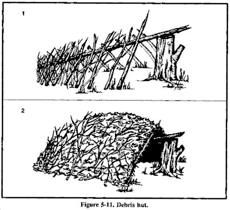

# Emergency Shelter

Shelter's job is to keep you at a safe body temperature: block wind and precipitation, insulate from the ground, and trap heat (or shade from sun).

## Site selection

- Flat, well drained, slightly raised. Not in dry riverbeds (flash floods), at valley bottoms (cold air pools there), on ridgetops (wind/lightning), or under dead trees/branches ("widowmakers").
- Near water and firewood but at least 200 ft from water (insects, animals, floods).
- Natural windbreaks: rock walls, dense trees, terrain.
- In avalanche terrain, stay out of gullies and slopes of 30–45°.

## Insulate from the ground first

The ground steals heat faster than air. Pile at least 6–12 inches (compressed 4+ inches) of dry leaves, pine boughs, grass, or a foam pad under you.

## Shelter types

### Debris hut (no tools, cold weather)
1. Ridgepole: a sturdy pole 1.5 times your height, one end on a stump or forked sticks about waist high, the other on the ground.
2. Lean ribs along both sides at a steep angle, close together, to form a narrow wedge just big enough to lie in.
3. Pile leaves/debris **at least 2–3 feet thick** (thicker in colder weather) over everything, then add sticks to hold it down.
4. Stuff the inside full of dry leaves and crawl in; plug the entrance with a leaf-stuffed bag or debris pile.

### Tarp shelters
- **A-frame:** ridgeline between two trees, tarp draped over, edges staked down. Good rain protection.
- **Lean-to:** one edge high, the other staked to the ground, back to the wind — pairs with a fire and reflector in front.
- **Diamond / plow point:** one corner high, three staked; fast and wind-resistant.
- Taut-line hitch for adjustable guylines; see *Knots and Cordage*.

### Snow shelters
- **Quinzhee:** pile snow 6–7 ft high, let it sinter 1–2 hours, insert 12-inch sticks all over as depth gauges, hollow out to the sticks. Raised sleeping platform above the entrance level (cold air sinks). **Poke a ventilation hole** in the roof.
- **Snow trench:** dig a trench body-length, cover with branches/tarp and snow. Fast.
- **Tree well:** the hollow under a large conifer — beware of falling snow from branches.
- Snow shelters stay near 32°F (0°C) inside regardless of outside temperature. Never use a stove in one without ventilation.

### Hot climate shade
- Double-layer tarp with a 1–2 ft air gap between layers reduces heat dramatically.
- Dig down 1–2 feet; the soil underneath is cooler.
- Rest during the day, move at night.

## Sheltering at home in a grid-down winter

- Choose one small interior room, ideally on the south side; close off the rest of the house.
- Hang blankets over windows and doorways; tent a blanket fort over beds.
- Everyone sleeps together; hats on.
- Use only heaters rated for indoor use; keep battery-powered CO alarms.
- Keep pipes from freezing: drain them, or let faucets drip.

## Body heat basics

- Stay dry: wet clothing loses up to 90% of its insulation (except wool and synthetics, which retain some).
- Layer: base (wicking), insulation (fleece/wool/down), shell (wind/rain).
- Eat fats and carbs before sleeping; urinate before bed (the body wastes heat warming a full bladder).
- Fill a bottle with hot water and place it at your core or groin.
