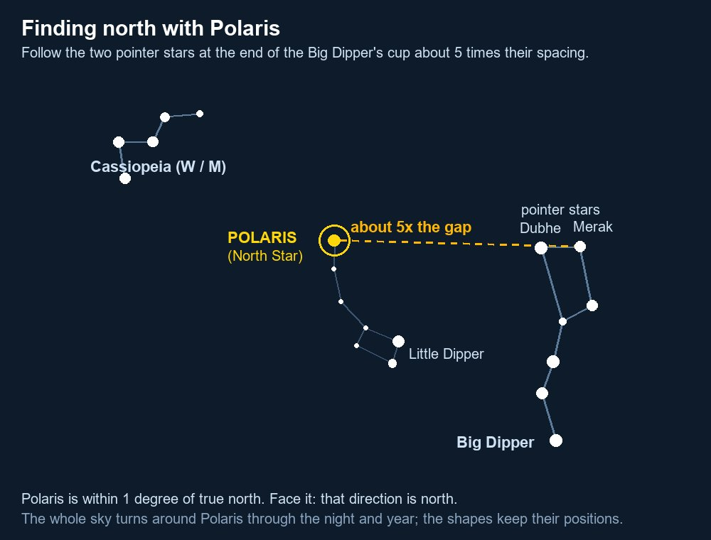

# Navigation Without a Compass

All of the United States is in the Northern Hemisphere, which makes the methods below reliable everywhere from Hawaii (~19–22°N) to Alaska.

## Shadow-stick method (sun)

1. Push a straight stick (about 3 ft) upright in level ground in sunshine.
2. Mark the tip of its shadow with a pebble (first mark = **west**).
3. Wait 15–30 minutes and mark the new shadow tip (second mark = **east**).
4. A line from the first to the second mark runs roughly **west → east**. Stand with the first mark on your left and the second on your right — you are facing north.
Most accurate near midday; works any time the sun casts a shadow.

## The sun's path

- Rises roughly in the east and sets roughly in the west. In summer it rises/sets north of east/west; in winter, south of east/west. Only exactly east/west at the equinoxes (around March 20 and September 22).
- At local solar noon in the contiguous US, the sun is due **south** and shadows point due **north** (Hawaii in midsummer is a near-exception: the sun can be almost overhead or slightly north).

## Analog watch method

1. Hold the watch flat and point the **hour hand at the sun**.
2. Halfway between the hour hand and 12 o'clock is **south**. (During daylight saving time, use 1 o'clock instead of 12.)
3. No analog watch? Draw one on paper with the current time.
Rough method — errors of 15°+ are common, worse near midday in summer and at low latitudes.

## North Star (Polaris)

- Find the **Big Dipper**. The two stars at the outer edge of its "cup" (the pointer stars) point to Polaris, about **five times the distance** between them.
- Polaris is the end of the Little Dipper's handle and is not especially bright.
- Alternatively, **Cassiopeia** (a W or M shape) sits opposite the Big Dipper; Polaris is roughly midway between them.
- Polaris is within 1° of true north. Its height above the horizon equals your latitude (a fist at arm's length ≈ 10°) — useful for estimating how far north you are.

## Orion

Visible in winter evenings. The top star of Orion's belt (Mintaka) rises almost exactly due **east** and sets due **west**. The sword hanging from the belt points roughly south.

## Moon

- If the moon rises before the sun sets, the lit side faces west. If it rises after midnight, the lit side faces east.
- **Crescent moon trick:** draw a line through the two horns of a crescent and extend it to the horizon — it points roughly **south** in the Northern Hemisphere.

## Star motion

Stick two sticks in the ground and sight a star over their tops. Watch for a few minutes:
- Star rises → you face **east**. Star falls → **west**.
- Star moves right → **south**. Moves left → **north**.

## Improvised compass

Stroke a sewing needle, thin wire, or razor blade in **one direction** with a magnet (speaker, fridge magnet) 30–50 times, or with silk/hair. Float it on a leaf in still water. It aligns north–south; confirm which end is north with the sun or stars.

## Nature signs (unreliable — use only to support other methods)

- Moss grows on whichever side is shadiest and wettest — not reliably north.
- Snow melts faster on south-facing slopes; south slopes in the West are drier, with more grass and fewer trees.
- Prevailing winds (westerly across most of the US) bend trees and shape snowdrifts.
- Satellite TV dishes in the contiguous US generally face **south** (southwest/southeast) — a handy urban clue.
- Churches with traditional orientation often have the altar to the east.
